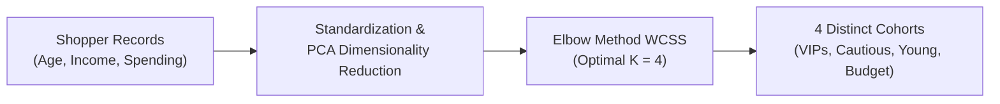

# Customer Segmentation Using K-Means Clustering & PCA

[](https://www.python.org/)
[](https://scikit-learn.org/)
[](https://pandas.pydata.org/)
[](https://matplotlib.org/)
[](LICENSE)

---

### The Problem It Solves
One-size-fits-all marketing campaigns yield poor return on investment and fail to engage diverse customer segments. Retailers lack automated tools to uncover natural spending clusters without manual data labeling. This project provides an unsupervised machine learning clustering model to automatically segment shoppers into high-conversion cohorts.

### How It Solves It
Standardizes customer demographic and financial features via `StandardScaler`, compresses multidimensional relationships using Principal Component Analysis (PCA), and identifies optimal cluster density ($K = 4$) using the Elbow Method with K-Means++ centroid initialization.

---

### Quick Summary: What It Has Done & What It Does
*(Fast overview for users who want the essential takeaways without reading the full report)*

- **What It Has Done**:
  - Preprocessed 200 consumer profiles analyzing Age, Annual Income, and Spending Scores.
  - Evaluated Within-Cluster Sum of Squares (WCSS) across $K = 1 \dots 15$, pinpointing $K = 4$ as the optimal elbow point.
  - Decomposed features into orthogonal 2D and 3D PCA spaces to visualize cluster separability and centroid locations.
- **What It Does**:
  - Ingests unlabelled customer purchasing data and assigns each shopper to an actionable behavioral cluster (e.g., Affluent Spenders, Budget Conscious, or Young High-Velocity Shoppers).
  - Enables marketing teams to deploy targeted discounts and personalized VIP campaigns to maximize Customer Lifetime Value (LTV).

---

## Identified Customer Clusters ($K = 4$)

| Cluster Cohort | Profile Characteristics | Recommended Business Strategy |
| :---: | :--- | :--- |
| **Cluster 1: Target VIPs** | High Annual Income + High Spending Score | Exclusive product launches, VIP loyalty programs |
| **Cluster 2: Cautious Affluent** | High Annual Income + Low Spending Score | Value propositions, quality assurance, premium promotions |
| **Cluster 3: Young Spenders** | Lower Annual Income + High Spending Score | Trend-driven sales, social commerce discounts |
| **Cluster 4: Standard Budget** | Moderate/Low Income + Balanced Spending | Bulk deals, everyday discount promotions |



---

## Quick Start

```bash
# Clone the repository
git clone https://github.com/Umair-Nawaz0/kmeans-customer-segmentation.git
cd kmeans-customer-segmentation

# Install dependencies
pip install pandas numpy scikit-learn matplotlib
```

The full report and 2D/3D cluster visualizations are available in [`kmeans_customer_segmentation.pdf`](kmeans_customer_segmentation.pdf).

---

## Author

**Umair Nawaz**  
- GitHub: [@Umair-Nawaz0](https://github.com/Umair-Nawaz0)
