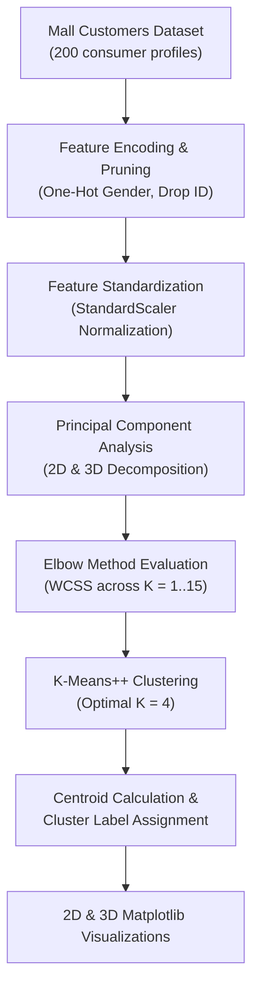

# Customer Segmentation Using K-Means Clustering & PCA

[](https://www.python.org/)
[](https://scikit-learn.org/)
[](https://pandas.pydata.org/)
[](https://matplotlib.org/)
[](LICENSE)

An unsupervised machine learning project performing **Customer Market Segmentation** on retail shopping data using **K-Means Clustering** combined with **Principal Component Analysis (PCA)** for multidimensional feature compression and 2D/3D cluster centroid visualization.

---

## Table of Contents

- [Overview](#overview)
- [Key Highlights](#key-highlights)
- [Workflow Architecture](#workflow-architecture)
- [Dataset & Behavioral Features](#dataset--behavioral-features)
- [Preprocessing & Dimensionality Reduction (PCA)](#preprocessing--dimensionality-reduction-pca)
- [Optimal Cluster Determination (Elbow Method)](#optimal-cluster-determination-elbow-method)
- [Cluster Visualization (2D & 3D Projections)](#cluster-visualization-2d--3d-projections)
- [Repository Structure](#repository-structure)
- [Getting Started](#getting-started)
- [Author](#author)

---

## Overview

Customer segmentation is fundamental to modern marketing, consumer personalization, and resource allocation. By grouping customers into distinct behavioral clusters based on purchasing power, demographic patterns, and spending scores, businesses can tailor marketing campaigns to maximize customer lifetime value (LTV).

This project implements an unsupervised clustering pipeline utilizing the **Elbow Method (WCSS)** to pinpoint optimal cluster granularity ($K = 4$) and projects high-dimensional customer profiles into **2D and 3D PCA vector spaces**.

---

## Key Highlights

- **Standardization & Encoding**: One-hot encoded categorical demographics (`Gender`) and standardized all continuous attributes (`Age`, `Annual Income`, `Spending Score`) via `StandardScaler`.
- **Dimensionality Reduction with PCA**: Decomposed scaled multi-feature spaces into orthogonal principal components while preserving maximum variance.
- **Elbow Heuristic with WCSS**: Iterated through $K = 1 \dots 15$ clusters, identifying the point of diminishing returns at $K = 4$.
- **K-Means++ Initialization**: Utilized `k-means++` seeding to accelerate convergence and avoid sub-optimal local minima.
- **2D & 3D Centroid Mapping**: Rendered 2D scatter plots and 3D interactive projections displaying distinct customer cohorts and their cluster centroids.

---

## Workflow Architecture



---

## Dataset & Behavioral Features

The project evaluates customer behavioral data from the Mall Customers repository:

| Feature | Type | Description |
| :--- | :--- | :--- |
| `Gender` | Categorical | Customer gender (Male / Female, One-Hot Encoded) |
| `Age` | Numerical | Customer age in years |
| `Annual Income (k$)` | Numerical | Annual customer earnings in thousands of dollars |
| `Spending Score (1-100)` | Numerical | Score assigned by mall based on customer behavior & spending habits |

---

## Preprocessing & Dimensionality Reduction (PCA)

1. **Standardization**: Mapped continuous attributes to $\mu=0, \sigma=1$ to prevent features with wide numerical spans (like `Annual Income`) from dominating Euclidean distance calculations.
2. **Principal Component Analysis (PCA)**: Extracted principal axes capturing the primary dimensions of customer behavioral variation for 2D and 3D clustering representations.

---

## Optimal Cluster Determination (Elbow Method)

To identify the optimal number of customer groups, Within-Cluster Sum of Squares (WCSS / Inertia) was calculated across $K \in [1, 15]$:

$$WCSS = \sum_{k=1}^K \sum_{x \in S_k} ||x - \mu_k||^2$$

The elbow curve exhibited an inflection point at **$K = 4$**, representing the optimal balance between cluster cohesion and model parsimony.

---

## Cluster Visualization (2D & 3D Projections)

- **2D PCA Projection**: Displays customer clusters mapped onto the first two principal components with marked centroid coordinates.
- **3D PCA Projection**: Uses Matplotlib `Axes3D` to reveal depth separation across three orthogonal dimensions, cleanly segregating distinct customer spending tiers:
  1. *Affluent High-Spenders* (High Income, High Spending Score)
  2. *Affluent Conservative Savers* (High Income, Low Spending Score)
  3. *Budget Enthusiasts* (Low Income, High Spending Score)
  4. *Conservative Low-Income Shoppers* (Low Income, Low Spending Score)

---

## Repository Structure

```plaintext
kmeans-customer-segmentation/
├── kmeans_customer_segmentation.pdf   # Complete project report & exported notebook
└── README.md                          # Project documentation
```

---

## Getting Started

### Prerequisites

- Python 3.8+
- Scikit-Learn
- Pandas
- NumPy
- Matplotlib

### Environment Setup

```bash
pip install pandas numpy scikit-learn matplotlib
```

### Viewing Project Documentation

Inspect the complete experimental pipeline, code executions, and 2D/3D visualizations in [`kmeans_customer_segmentation.pdf`](./kmeans_customer_segmentation.pdf).

---

## Author

**Umair Nawaz**  
- GitHub: [@Umair-Nawaz0](https://github.com/Umair-Nawaz0)
